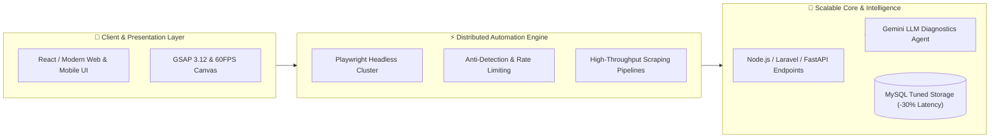

<div align="center">

<!-- Animated Waving Hero Banner (100% Reliable Camo Rendering) -->


<!-- Dynamic Neon Typing SVG (Balanced Across All Core Skills) -->
<a href="https://iamraj.me">
  
</a>

<p align="center">
  <a href="https://iamraj.me"></a>
  <a href="https://linkedin.com/in/raj-soni-a87b27312"></a>
  <a href="mailto:iamrajsoni1@gmail.com"></a>
  <a href="https://instagram.com/i._.amraj"></a>
  
</p>

```javascript
const engineer = {
  name: "Raj Soni",
  currentRole: "Full Stack Developer @ Fireflies Infotech Pvt. Ltd.",
  education: "Master of Computer Applications (MCA)",
  credentials: "IIT Kanpur (E&ICT Academy) Certified in Python & Software Eng.",
  awards: ["Codex Matrix 3rd Prize Winner (Health Advisor AI)"],
  coreCompetencies: {
    automation: ["Playwright", "Puppeteer", "Anti-Detection", "Distributed Data Mining"],
    backend: ["Node.js", "Python (FastAPI)", "Laravel", "MySQL (Query Tuned)"],
    frontend: ["React", "JavaScript (ES6+)", "TypeScript", "TailwindCSS"],
    creativeTech: ["GSAP 3.12", "HTML5 Canvas (60FPS)", "Interactive Compositing"],
    aiEngineering: ["Google Gemini API", "OpenAI", "Autonomous Agent Workflows"]
  },
  motto: "Building reliable, high-throughput systems that turn complex workflows into seconds."
};
```

---

</div>

## 🚀 Professional Profile & Impact

- 💼 **Full Stack Developer** at **Fireflies Infotech Pvt. Ltd.**, architecting multi-tenant SaaS ERP platforms, distributed scrapers, and AI customer tooling.
- ⚡ **Database & Performance Optimization:** Reduced ERP query latency by **30%** via MySQL index refactoring, query tuning, and intelligent caching strategies.
- 🏆 **Codex Matrix Winner:** Awarded **3rd Prize at Codex Matrix** for designing **Health Advisor AI**, an intelligent medical diagnostic assistant using Gemini LLMs.
- 🎓 **Education & Credentials:** Pursuing **MCA** (Data Structures, DBMS, Distributed Systems) & certified in **Python & Software Engineering** from **E&ICT Academy, IIT Kanpur**.

---

## 🏗️ End-to-End System Architecture



---

## 🛠️ Comprehensive Technical Arsenal

<div align="center">

### 🌐 Backend & Distributed Architectures
<p>
  
  
  
  
  
  
  
</p>

### 🕷️ Automation, Scraping & Data Mining
<p>
  
  
  
  
</p>

### 💻 Frontend & Modern Web Engineering
<p>
  
  
  
  
  
  
</p>

### 🗄️ Databases & DevOps
<p>
  
  
  
  
</p>

### 🤖 AI Engineering & Autonomous Tooling
<p>
  
  
  
</p>

---

</div>

## 🌟 Featured Engineering Projects

| Domain | Project | Tech Stack | Production Highlights | Source / Demo |
| :--- | :--- | :--- | :--- | :---: |
| **Automation** | **Dual-Engine Lead Extractor** | `Node.js` `Playwright` `ExcelJS` | High-concurrency headless data mining pipeline with localized search filtering, automated anti-detection, and Excel generation. | [Repository](https://github.com/i-amraj/raj_leads_nodejs) |
| **AI & LLMs** | **Health Advisor AI** | `Python` `Google Gemini` `FastAPI` | **3rd Prize Winner at Codex Matrix.** Intelligent diagnostic assistant performing dynamic patient symptom triaging and structured reports. | [Repository](https://github.com/i-amraj/health_checker-ai-assistant) |
| **Creative Tech** | **Canvas Reveal Engine** | `HTML5 Canvas` `GSAP 3.12` `JS` | 60FPS high-performance interactive compositing and reveal library with 16+ fluid shaders and AI prompts. | [Repository](https://github.com/i-amraj/gsap-reveals) |
| **Web Apps** | **Interactive Portfolio Hub** | `JavaScript` `CSS3` `Canvas` | Personal showcase of production SaaS applications, client case studies, and engineering logs. | [Live Demo](https://iamraj.me) |
| **Client-Side Tools** | **Invoice Generator & Sync** | `Vanilla JS` `jsPDF` `GAS Proxy` | Zero-backend client-side invoice generator with automated PDF rendering, digital signatures, and GitHub sync. | [Live App](http://invoice.iamraj.me/) |
| **Utilities** | **OptiCompress PRO** | `Web Workers` `pdf-lib` `Vanilla JS` | 100% private, client-side batch compressor for images and PDFs to exact target limits without server upload. | [Repository](https://github.com/i-amraj/Size-Reduesor) |
| **Mobile** | **Raj Music (Android)** | `Kotlin` `Jetpack Compose` `M3` | Modern audio player engine with dynamic day/night ambient backgrounds, background playback, and voice search. | [Repository](https://github.com/i-amraj/free_music_app) |

---

## ⚡ Creative Coding Showcase: Canvas Reveals Engine

> 🎨 **[Canvas Reveals (`canvas-reveals`)](https://github.com/i-amraj/gsap-reveals)** is a production-ready, zero-dependency library for **60FPS interactive HTML5 Canvas compositing & GSAP reveal animations**.
> - **16+ Shader & Reveal Styles:** Fluid smoke particles, water ripple wipes, cyberpunk matrices, Japanese watercolor splatters, and vertical split curtains.
> - **60FPS Offscreen Compositing:** Built with offscreen mask canvas architecture using `destination-in` global composite operations.
> - **AI-Assisted Architecture:** Includes copy-pasteable `prompt.md` files for effortless integration into modern web apps.

---

## 📈 Activity & GitHub Stats

<div align="center">


<br/><br/>


<br/><br/>

<!-- Animated Waving Footer -->


</div>

<div align="center">


*PS — the waving guy is my 3D avatar. He hosts my code-animated reels on Instagram [@i.raj1801](https://www.instagram.com/i.raj1801/) — the full video system lives in [iraj1801-video-knowledge-base](https://github.com/i-amraj/iraj1801-video-knowledge-base).*

</div>

## 📬 Let's Connect & Collaborate

- 💼 **LinkedIn:** [linkedin.com/in/raj-soni-a87b27312](https://linkedin.com/in/raj-soni-a87b27312)
- 🌐 **Personal Website:** [iamraj.me](https://iamraj.me)
- 📧 **Direct Email:** [iamrajsoni1@gmail.com](mailto:iamrajsoni1@gmail.com)
- 💬 *Open to High-Impact Software Engineering Roles (Full-Stack / Automation / Backend / Creative Frontend) & Strategic Consulting.*
