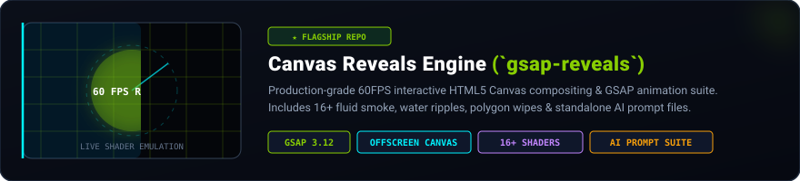
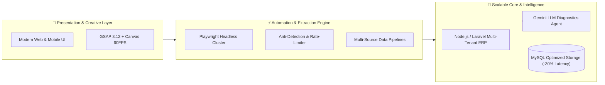
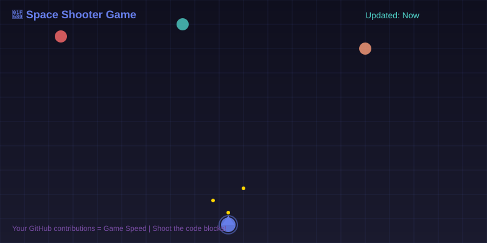

<div align="center">

<!-- Animated Cyber Hero Banner with GSAP & Canvas Aesthetics -->
<a href="https://github.com/i-amraj/gsap-reveals">
  
</a>

<br/>

<!-- Dynamic Neon Typing SVG -->
<a href="https://iamraj.me">
  
</a>

<p align="center">
  <a href="https://iamraj.me"></a>
  <a href="https://linkedin.com/in/raj-soni-a87b27312"></a>
  <a href="mailto:iamrajsoni1@gmail.com"></a>
  <a href="https://instagram.com/i._.amraj"></a>
  
</p>

```javascript
const engineer = {
  name: "Raj Soni",
  currentRole: "Full Stack Developer @ Fireflies Infotech Pvt. Ltd.",
  education: "Master of Computer Applications (MCA)",
  creativeTech: ["GSAP 3.12", "HTML5 Canvas", "60FPS Compositing Shaders"],
  systemsFocus: ["Multi-Tenant SaaS ERPs", "Headless Browser Automation", "Distributed Scrapers", "AI Agents"],
  motto: "Engineering high-throughput systems and high-aesthetic creative interfaces."
};
```


</div>

## ⚡ Featured Engineering Spotlight: Canvas Reveals Engine

<div align="center">

<a href="https://github.com/i-amraj/gsap-reveals">
  
</a>

</div>

> 🎨 **[Canvas Reveals (`canvas-reveals`)](https://github.com/i-amraj/gsap-reveals)** is a production-ready, zero-dependency library for **60FPS interactive HTML5 Canvas compositing & GSAP reveal animations**.
> - **16+ Shader & Reveal Styles:** Fluid smoke particles, water ripple wipes, cyberpunk matrices, Japanese watercolor splatters, and vertical split curtains.
> - **60FPS Offscreen Compositing:** Built with offscreen mask canvas architecture using `destination-in` global composite operations.
> - **AI-Assisted Architecture:** Includes copy-pasteable `prompt.md` files for effortless integration into modern web apps.

<div align="center">
  
</div>

## 🚀 Professional Profile & Impact

- 💼 **Full Stack Developer** at **Fireflies Infotech Pvt. Ltd.**, architecting multi-tenant SaaS platforms, distributed scrapers, and AI customer tooling.
- ⚡ **Database & System Optimization:** Reduced ERP query latency by **30%** via MySQL index refactoring, query tuning, and caching strategies.
- 🏆 **Hackathon Winner:** Awarded **3rd Prize** at a regional hackathon for designing **Health Advisor AI**, an intelligent medical diagnostic assistant using Gemini LLMs.
- 🎓 **Education & Credentials:** Pursuing **MCA** (Data Structures, DBMS, Distributed Systems) & certified in **Python & Software Engineering** from **E&ICT Academy, IIT Kanpur**.

<div align="center">
  
</div>

## 🏗️ System Architecture & Engineering Blueprint



<div align="center">
  
</div>

## 🛠️ Technical Competencies & Impact Arsenal

<div align="center">

### 🎨 Creative Engineering & Interactive Frontend
<p>
  
  
  
  
  
</p>

### 🕷️ Headless Automation & Distributed Scraping
<p>
  
  
  
  
  
</p>

### ⚡ Backend Systems & Enterprise Data
<p>
  
  
  
  
  
  
</p>

### 🤖 AI Engineering & Autonomous Tooling
<p>
  
  
  
</p>


</div>

## 🌟 Featured Engineering Projects

| Project | Tech Stack | Highlights | Demo / Source |
| :--- | :--- | :--- | :---: |
| **GSAP Reveal Animation Engine** | `HTML5 Canvas` `GSAP 3.12` `JS` | 60FPS high-performance interactive compositing and reveal library with 16+ fluid shaders and AI prompts. | [Repository](https://github.com/i-amraj/gsap-reveals) |
| **Dual-Engine Lead Extractor** | `Node.js` `Playwright` `ExcelJS` | Headless data mining pipeline with localized search filtering, automated anti-detection, and Excel generation. | [Repository](https://github.com/i-amraj/raj_leads_nodejs) |
| **Interactive Portfolio Hub** | `JavaScript` `CSS3` `Canvas` | Personal showcase of production SaaS applications, client case studies, and engineering logs. | [Live Demo](https://iamraj.me) |
| **Invoice Generator & Sync** | `Vanilla JS` `jsPDF` `GAS Proxy` | Zero-backend client-side invoice generator with automated PDF rendering, digital signatures, and GitHub sync. | [Live App](http://invoice.iamraj.me/) |
| **OptiCompress PRO** | `Web Workers` `pdf-lib` `Vanilla JS` | 100% private, client-side batch compressor for images and PDFs to exact target limits without server upload. | [Repository](https://github.com/i-amraj/Size-Reduesor) |
| **Raj Music (Android)** | `Kotlin` `Jetpack Compose` `M3` | Modern audio player engine with dynamic day/night ambient backgrounds, background playback, and voice search. | [Repository](https://github.com/i-amraj/free_music_app) |

<div align="center">
  
</div>

## 🎮 Interactive Creative Playground: Space Shooter Arcade

<div align="center">

<a href="https://raw.githack.com/i-amraj/i-amraj/main/game/index.html">
  
</a>

<p>
  <i>🕹️ Pure HTML5 Canvas &amp; SVG vector animations — click image to launch live arcade demo!</i>
</p>


</div>

## 📈 Activity & GitHub Stats

<div align="center">


<br/><br/>


<br/><br/>


</div>

## 📬 Let's Connect & Collaborate

- 💼 **LinkedIn:** [linkedin.com/in/raj-soni-a87b27312](https://linkedin.com/in/raj-soni-a87b27312)
- 🌐 **Personal Website:** [iamraj.me](https://iamraj.me)
- 📧 **Direct Email:** [iamrajsoni1@gmail.com](mailto:iamrajsoni1@gmail.com)
- 💬 *Open to High-Impact Software Engineering Roles (Full-Stack / Automation / Creative Frontend) & Strategic Consulting.*
