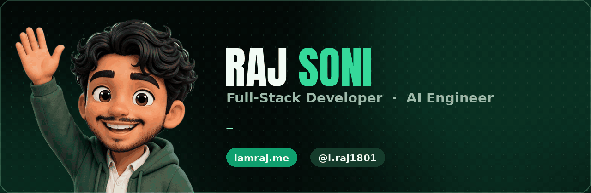
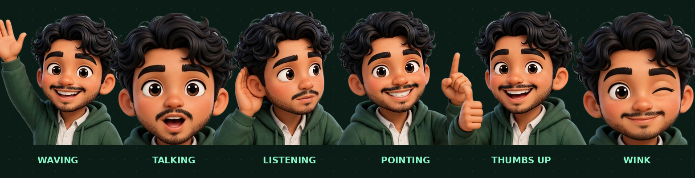
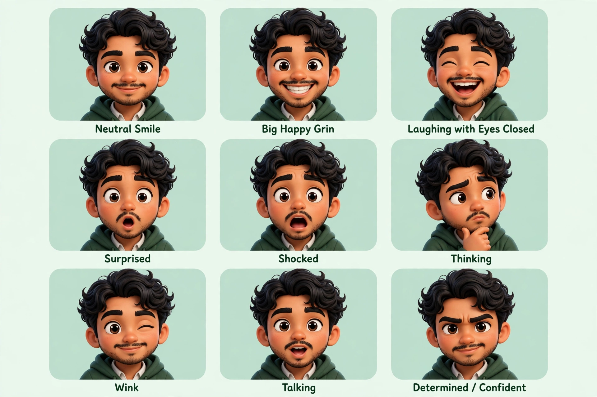

## Namaste, I'm Raj Soni

Full-Stack Developer & AI Engineer at **Fireflies Infotech**, Kanpur — I build SaaS, ERP and CRM products, and AI-integrated tools including WhatsApp automation, using **Python, Laravel, Gemini AI and Claude AI**.

My portfolio is live at **[iamraj.me](https://iamraj.me)** — 9 projects and counting.

- Currently: shipping production SaaS + AI agents that real businesses run on
- On the side: a code-animated video system for Instagram **[@i.raj1801](https://www.instagram.com/i.raj1801/)** — every reel is rendered from code, no editing software
- Open to: Full-Stack / AI Developer / Backend roles

## Meet my digital avatar

This 3D character is me — it hosts my reels, reacts, explains and points at things so I don't have to be on camera. Full sheet and pose library live in my [video knowledge base](https://github.com/i-amraj/iraj1801-video-knowledge-base).

## Featured projects

| Project | What it is |
|---|---|
| [free_stick_man_video_skill](https://github.com/i-amraj/free_stick_man_video_skill) | My free stickman video-making skill — the one my first viral-format reel was about |
| [free-ai-tools](https://github.com/i-amraj/free-ai-tools) | Free AI tools guide — Qwen AI + Fliki AI workflows, no paid plans needed |
| [free-auto-captions](https://github.com/i-amraj/free-auto-captions) | Free auto-captions guide — Edits by Instagram, Hindi supported, no watermark |
| [iraj1801-video-knowledge-base](https://github.com/i-amraj/iraj1801-video-knowledge-base) | My complete video system: identity, character, skills, scripts, comment agent |
| [studyquest-ai-teacher](https://github.com/i-amraj/studyquest-ai-teacher) | AI Teacher app — syllabus to lessons, tests and doubt chat in 4 languages |
| [myPortFolio](https://github.com/i-amraj/myPortFolio) | Source of [iamraj.me](https://iamraj.me) |

## Tech I work with

## Connect

- Portfolio: [iamraj.me](https://iamraj.me)
- LinkedIn: [raj-soni-a87b27312](https://www.linkedin.com/in/raj-soni-a87b27312)
- Instagram: [@i.raj1801](https://www.instagram.com/i.raj1801/)
- Email: hello@iamraj.me

*Built by Raj — banner, avatar and animations are my own, rendered from code.*

